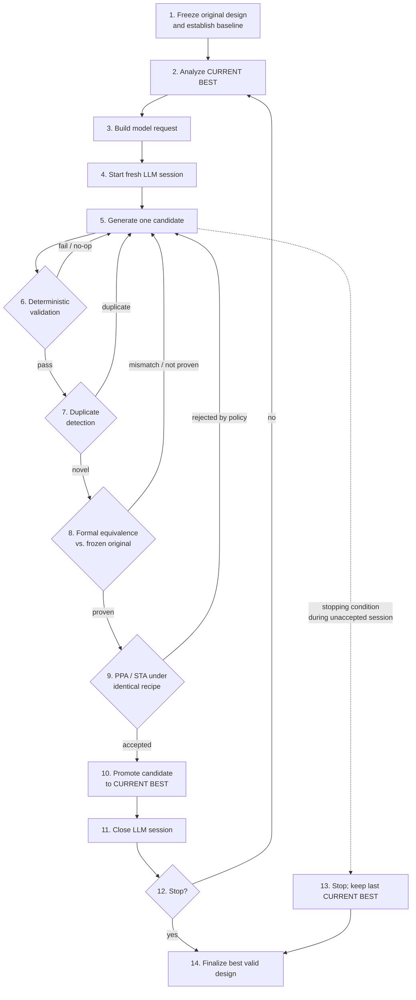

# Nebula

**A GenAI-assisted RTL timing optimization framework with EDA-verified correctness.**

Nebula combines LLM-based RTL rewriting with conventional EDA tooling (static timing analysis, formal equivalence checking, synthesis and physical implementation) in an iterative optimization loop. The LLM proposes RTL transformations; deterministic EDA tools decide whether each candidate is correct and whether it actually improves the design.

---

## Table of Contents

- [Motivation](#motivation)
- [Key Ideas](#key-ideas)
- [Models](#models)
- [System Architecture](#system-architecture)
- [Benchmarks](#benchmarks)
- [Results](#results)
- [Limitations](#limitations)
- [Future Work](#future-work)
- [Team](#team)

---

## Motivation

Digital designs must meet strict timing, area, power and implementation-efficiency requirements, not just functional ones. In a typical RTL-to-GDS flow, reaching timing closure means repeated rounds of synthesis, STA, critical-path inspection, RTL modification and re-verification. EDA tools can pinpoint timing violations accurately, but deciding *how* to change the RTL still relies on designer expertise.

LLMs are an attractive way to assist with this, but LLM-generated RTL can be:

- syntactically valid yet functionally incorrect,
- better on timing but worse on area or power,
- different in latency or sequential behaviour from the original.

Nebula's answer is to run the LLM inside a controlled workflow where **every candidate is validated by EDA tools** before it is trusted.

## Key Ideas

- **No LLM output is trusted on its own.** Every candidate goes through structural checks, formal equivalence, latency validation and PPA evaluation.
- **Three distinct designs are tracked at all times:**
  - **Golden RTL** – the immutable original, used as the formal reference for the entire run.
  - **Current Best** – the best verified implementation so far.
  - **Candidate** – the newly generated design under evaluation.
- **Critical paths guide, they don't confine.** Timing-critical regions are given to the model as diagnostic evidence, not as edit boundaries, so it can restructure logic outside the immediate critical path.
- **Supported transformations:** logic restructuring, arithmetic and mux reorganisation, pipelining, retiming, resource sharing, FSM optimization, and other legal transformations.
- **Latency-aware equivalence.** Pipelined or retimed candidates are proven equivalent to the golden design with a verified cycle shift, subject to a configurable `max_latency_regression_cycles`.
- **Structured feedback.** Failed attempts produce targeted feedback for the next iteration; accepted candidates become the new base.
- **Local duplicate detection.** Canonical fingerprints of every candidate are stored in a local database (never sent to the model) so duplicates don't consume the iteration budget.
- **Full traceability.** Each attempt records token usage, optimization mode, path groups considered, lint status, equivalence result, latency result, PPA result and the final promote/reject decision.

## Models

Two models were evaluated:

| Model | Notes |
|---|---|
| ChipSeek-R1-Qwen | RTL-optimization fine-tuned model from Hugging Face |
| **GPT-OSS-120B** | Produced more consistent and better results; **used for the demo run** |

## System Architecture

### Inputs

- Original RTL source bundle and top module
- Parameters, defines and include paths
- Clock/reset and timing constraints
- Technology/library and physical implementation recipe
- Optimization objective and acceptance policy
- Meaningful-iteration, resource and time limits

### Optimization Loop

### Step-by-step

<b>1. Freeze original design and establish baseline</b>

- Freeze the original RTL, top module and complete design configuration.
- Freeze clocks/resets, timing constraints, technology and physical recipe.
- Record hashes for all sources, constraints, recipes, manifests and references.
- Parse/elaborate, synthesize and run the selected physical comparison stage.
- Measure and store canonical baseline **WNS, TNS, area, power and latency**.
- Keep the original RTL as the immutable formal **GOLDEN** for the entire run.
- Set `CURRENT BEST = ORIGINAL` (RTL and metrics).
- Initialize the local candidate-fingerprint database and set the meaningful-iteration count to 0.

<b>2. Analyze the current best</b>

- Run timing/critical-path analysis on the current-best RTL.
- Map implementation evidence back to the full current-best design.
- Identify the current bottleneck and optimization unit.
- Measure current-best latency relative to the frozen original interface contract.

<b>3. Build the model request</b>

- Provide full source manifests and contents for both possible editing bases: **GOLDEN** and the unchanged **CURRENT BEST**.
- Provide current-best WNS, TNS, area, power, latency and mapped setup-path evidence.
- Provide compact source excerpts for the most useful RTL bottlenecks.
- Provide frozen clocks/resets, constraints, top-level correctness contract, objective and acceptance policy, including `max_latency_regression_cycles`.
- State that PPA deltas are always measured against the unchanged current best.
- Let the model pick exactly one editing base: `golden` or `current_best`.
- Treat bottleneck locations as evidence, never as edit boundaries.
- Require the top-module interface, parameters and clock/reset contract to be preserved.
- Strip backend-only provenance (absolute paths, cache metadata, large logs) from the model-facing packet while keeping it in saved artifacts.
- Never send the fingerprint database to the model.

<b>4. Start one fresh LLM session per current best</b>

- Bind the session to the current-best request and objective.
- Keep generated candidates and useful failure feedback within this session.
- Keep the session open until a candidate is accepted or the run stops.

<b>5. Generate one candidate</b>

The LLM returns exactly one JSON object matching the response schema, which specifies:

- one candidate-level editing base (`golden` or `current_best`),
- one replacement method (`whole_module` or `whole_file`),
- every complete module or `.v` file needed for a consistent candidate.

<b>6. Basic deterministic validation</b>

- Validate the JSON against the schema, the editing base and the replacement method; ensure every patch uses the same base and method.
- Verify base identities/hashes and that patches apply deterministically.
- `whole_module`: locate exactly one complete `module … endmodule` span per patch.
- `whole_file`: validate every rewritten or new design-relative `.v` file.
- Parse and elaborate the fully materialized candidate.
- Verify the top-module interface, parameters and clock/reset contract.
- Check declarations, drivers, consumers, instances, connections and cross-file completeness.
- **Allow** declared pipeline registers (in permitted clock/reset domains), declared retimed registers and legal FSM state changes. These go to formal verification and are not rejected just because their sequential topology differs from the golden design.
- **Reject** latches, multiple drivers, new clocks/domains, unsafe resets, unintended state, incomplete cross-file changes, unmaterializable patches and obvious token-level no-ops.
- A mismatch between predicted and verified latency is advisory only; reject on latency only if verified total regression exceeds `max_latency_regression_cycles`.

**On failure:** record the reason locally, send only useful feedback to the LLM, do **not** consume the iteration budget, and return to step 5 in the same session (or go to step 13 if a stopping condition is met).

<b>7. Early local duplicate detection</b>

- Canonicalize the candidate and compute its implementation fingerprint.
- Compare against fingerprints of **all** previously generated candidates (stored only in Nebula's local database).
- **Duplicate:** record locally, send only the duplicate reason to the LLM, don't consume budget, return to step 5.
- **Novel:** store the fingerprint, increment the meaningful-iteration count, continue to step 8.

<b>8. Formal equivalence against the frozen original</b>

- **GOLDEN** is always the immutable original RTL, never a previous rewrite. **CANDIDATE** is the fully materialized design, whatever its editing base.
- Use the same configuration, parameters, defines and include paths; compare only the frozen top-module I/O boundary.
- Independently verify candidate latency. For a verified latency change ΔL, prove `candidate_out(t + ΔL) == golden_out(t)`, accounting for reset and pipeline warm-up.
- Fixed-latency designs: prove each output with its verified cycle shift under the same input trace. Variable-latency or protocol-driven designs: prove ordered transaction equivalence, with the latency limit enforced per transaction.
- Start from the frozen legal reset/initial state, apply identical input assumptions to both designs, mask only the justified warm-up interval, and never add candidate-specific assumptions that could hide mismatches.
- No correspondence is required between internal wires, registers, pipeline boundaries, FSM encodings, submodule ports or hierarchy.
- Distinguish a real counterexample from timeouts, unsupported constructs, capacity limits or infrastructure failures. **Only real semantic counterexamples or verified policy violations reject a candidate**; inconclusive results are retried, not blamed on the candidate.

<b>9. Candidate PPA / STA under an identical recipe</b>

- Use exactly the same technology, libraries, clocks, constraints, physical recipe, flow settings and comparison stage as the baseline.
- Synthesize, implement, and run STA, area and power analysis.
- Collect canonical WNS, TNS, area, power and verified latency; confirm metric definitions match.
- Compare WNS, TNS, area and power against the unchanged current best.
- Record the latency delta vs. current best and total latency regression vs. the frozen original; apply `max_latency_regression_cycles` to the latter only.
- On an invalid comparison, PPA failure or policy rejection: keep the result and reason, send useful feedback to the LLM, leave GOLDEN and CURRENT BEST unchanged, and return to step 5.

<b>10–11. Promote and close session</b>

- Set `CURRENT BEST` to the accepted candidate (RTL and metrics, including verified latency).
- Save accepted RTL, metrics, formal evidence, physical implementation evidence, fingerprint, PPA deltas and result.
- Close the LLM session tied to the previous current best; its conversation is **not** carried forward. Permanent history lives only in Nebula's local records.

<b>12–14. Stopping and finalization</b>

**Stopping conditions** (checked after each promotion):

- Optimization objective reached
- Maximum meaningful iterations reached
- No useful valid transformation remains (declared by the model in its JSON response)
- Resource/time budget exhausted
- Any other configured stopping condition

If none are met, re-run timing analysis on the new current best (the critical path may have moved), build a fresh request and start a **new** LLM session at step 2.

If a stop occurs mid-session (step 13), the session is closed and the last accepted current best is kept; the rejected candidate is never promoted.

**Final output (step 14):**

- Best formally equivalent RTL
- Frozen original RTL with baseline WNS/TNS/area/power/latency
- Final metrics and deltas
- Formal and physical implementation evidence
- Accepted and rejected candidate records with reasons
- Candidate fingerprints and duplicate records
- Full reproducibility data: identities, recipes, constraints and hashes

### Session / Memory Model

| Memory | Scope | Purpose |
|---|---|---|
| LLM session | One current-best RTL | Short-term reasoning memory |
| Local fingerprint database | Entire run | Permanent duplicate memory across sessions |

## Benchmarks

| Benchmark | Designs | Purpose | Key Characteristics |
|---|---|---|---|
| RTL Optimization Set | 40 | GenAI optimization evaluation | Arithmetic, mux, FSM, divider, ALU, MAC and control logic |
| Multi-Clock Set | 20 | System-level validation | 5 async master clocks, 5+ generated clocks, CDC paths, clock dividers, ~50K-cell scale |

### RTL Optimization Benchmark

40 RTL designs from the **RTL-OPT** GitHub repository, each with a reference implementation. Coverage includes adders, subtractors, multipliers, dividers, comparators, multiplexers, decoders, ALUs, MAC units, registers, address-calculation logic and FSMs (e.g. `adder`, `adder_carry`, `adder_select`, `mac`, `mul`, `divider`, `mux_large`, `alu`, `comparator`, `fsm` variants). This exercises arithmetic restructuring, combinational-depth reduction, mux restructuring, pipelining and FSM optimization.

### Multi-Clock Benchmark Suite

20 synthesizable designs built for system-level evaluation:

- **5 independent asynchronous master clocks** per design, each with at least one divided generated clock → **10 clock domains** per design.
- Real **CDC paths** using asynchronous FIFOs and multi-flop synchronizers, arranged in a ring so every domain both sends and receives.
- Varying odd/even divider ratios, datapath widths, counter counts, FIFO depths and logic replication.
- Generic synthesized size of roughly **37K–62K cells** (centered on ~50K); final cell count, area, timing and power come from the OpenROAD flow.
- Deliberate optimization targets: a shift-add MAC with a long combinational path, linear priority encoders, duplicated comparators, wide arithmetic reductions, oversized synchronizers/FIFOs and free-running divider logic.

## Results

### RTL-OPT: overall

32 of the 40 designs ran end-to-end through OpenROAD; the other 8 are excluded from all percentages.

A design counts as a **useful optimization** if at least one candidate passed correctness and latency verification, completed PPA evaluation, and showed a measurable improvement in at least one physical metric.

| Outcome | Designs | Share |
|---|---|---|
| Useful verified improvement | 22 / 32 | **68.75%** |
| No meaningful improvement within search budget | 10 / 32 | 31.25% |

### RTL-OPT: improvement by metric

Thresholds: ≥ 10 ps for setup/hold slack, ≥ 1% for area/power. Categories are independent; one design can count in several.

| Metric | Designs improved | Share | Median best improvement* |
|---|---|---|---|
| Setup slack | 19 / 32 | 59.4% | ~64.1 ps |
| Hold slack | 12 / 32 | 37.5% | ~28.3 ps |
| Area | 14 / 32 | 43.8% | ~11.24% |
| Power | 15 / 32 | 46.9% | ~16.89% |

\* Median among designs meeting the threshold for that metric.

Without the 10 ps threshold, the best measured candidate improved setup WNS in **23 of 32 designs (71.9%)**.

### CDC evaluation

Three intermediate designs (`cdc_deep_logic`, `cdc_mac`, `cdc_fsm`), 8 model calls each, with up to one destination-clock cycle of allowed latency regression.

| Stage | Passed | Rate |
|---|---|---|
| Candidates generated | 24 / 24 | – |
| RTL + CDC/RDC structural validation | 23 / 24 | 95.8% |
| Formal equivalence + latency alignment | 14 / 24 | 58.3% |
| Physical PPA evaluation completed | 14 / 14 | 100% |

### Takeaways

- The GenAI optimizer found measurable timing improvements in most designs with physical metrics.
- **RTL timing optimization is multi-objective.** Some candidates gained significant WNS at a large area and power cost, so the biggest timing win is not always the best implementation. Keeping physical metrics inside the loop is what separates useful transformations from ones that just move the problem elsewhere.

Detailed per-design results (Golden vs. Best #1 and Best #2, with transformation, formal result, latency change, setup/hold slack, area, power and deltas) are in the accompanying Excel results file.

## Limitations

- **Timing-to-RTL mapping is imperfect.** Synthesis and technology mapping blur the link between physical timing paths and RTL, which limits how precise the model's guidance can be.
- **LLM output is exploratory.** Candidates may be structurally wrong, fail formal checks, duplicate earlier attempts, or worsen PPA. The validation stages catch this, but each adds compute cost.
- **Formal scalability.** Pipelining, retiming and FSM restructuring change sequential structure; complex multi-clock or protocol-based designs can hit timeouts or capacity limits instead of reaching a proof.
- **Throughput.** Every formally valid candidate is fully synthesized and implemented under the same recipe. This keeps comparisons fair but makes large-scale exploration expensive, especially near the ~50K-cell target.

## Future Work

- More accurate RTL-to-timing mapping for better model context
- Hierarchical optimization for larger designs
- Parallel generation and evaluation of multiple candidates
- **Fine-tuning / reinforcement learning** on past optimization runs, using EDA results (timing, area, power, latency, verification outcome) as an objective reward signal
- Incremental synthesis and verification
- Stronger CDC-aware and multi-clock formal techniques
- Automated Pareto exploration of timing-area-power trade-offs
- Smarter stopping criteria based on measured progress rather than fixed iteration or resource limits

The long-term goal is to grow Nebula from an iterative GenAI-assisted optimizer into a scalable design-space exploration system that learns from previous runs while keeping deterministic, EDA-based verification and acceptance.

## Team

| Name | Email |
|---|---|
| Aniket Gupta | f20230722@pilani.bits-pilani.ac.in |
| Adwitya Vyas | f20230324@pilani.bits-pilani.ac.in |
| Sagnik Roy | f20230702@pilani.bits-pilani.ac.in |
